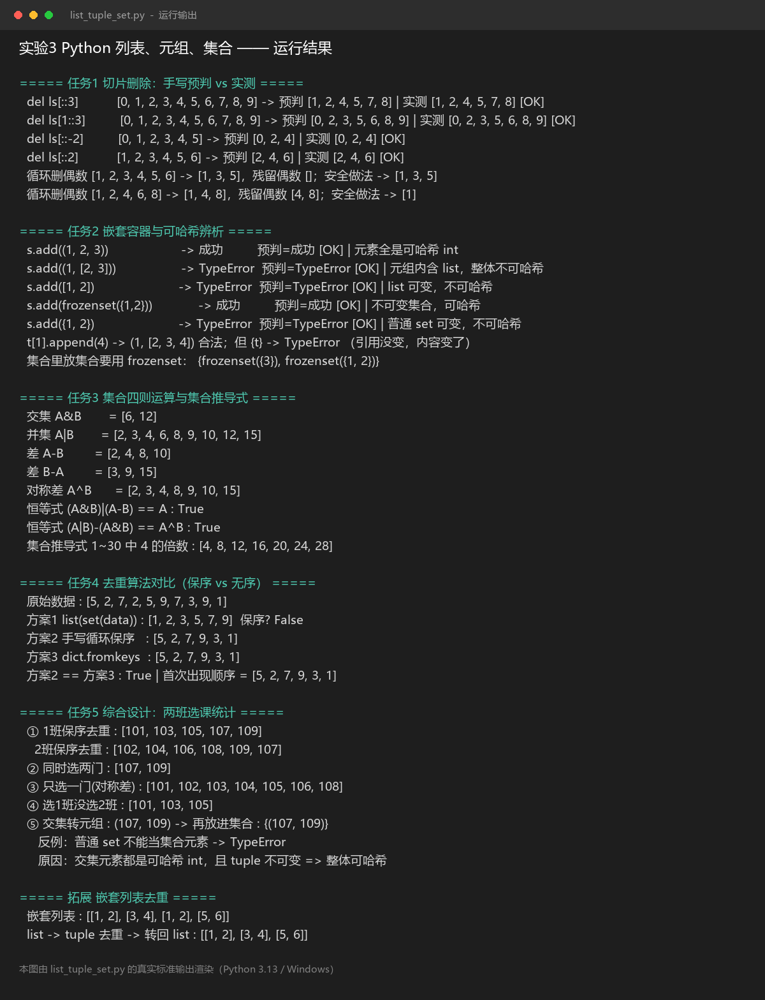

# 实验 3：Python 列表、元组、集合

> 课程实验，目录按要求命名 `exp3/`，与前面 6 份编程作业分开。
> **运行**：进入本目录执行 `python list_tuple_set.py`（纯标准库，无第三方依赖），控制台一次输出 5 个任务 + 拓展的全部结果。

## 一、实验名称、目的与环境

- **名称**：Python 列表、元组、集合（验证 + 综合设计 + 分析探究，2 学时）
- **目的**：弄清三种容器的可变性、有序性与可哈希约束；掌握切片删除的索引计算、集合四种运算与推导式；理解去重丢顺序的原因并自己实现保序去重；能解释 `TypeError: unhashable type` 和遍历中删元素的 bug。
- **环境**：Python 3.13.0（本机 `D:\pycharm\venv`）、PyCharm、`list_tuple_set.py`，**不需要安装任何第三方库**。

## 二、实验原理（自己的话）

- 列表是动态数组，存的是**对象引用**；切片删除先把要删的**原始下标一次性算好**，再整体搬移，不是删一个重算一次。
- 元组的「不可变」指引用不能改，不保证引用指向的对象内容不动；只要有一个元素不可哈希，整个元组就不可哈希。
- 集合基于哈希表，元素必须**生命周期内哈希值不变**。`set` 可变所以不能当元素；`frozenset` 不可变、哈希稳定，可以嵌套。
- `list(set(x))` 去重会丢顺序；要保序就记住「第一次出现」，或用 Python 3.7+ 有序字典的键。

## 三、实验步骤与源代码

| 步骤 | 做法 |
| --- | --- |
| 任务 1 | 把 4 组切片写成数据表，**先手写预判**，再由 `del ls[切片]` 实算并自动打 `[OK]/[差异]`；另外用两组数据对比 `for` + `remove` 与推导式 |
| 任务 2 | 把 5 条 `s.add(...)` 放进循环，用 `try/except TypeError` 逐条记录成功或异常，并附理由 |
| 任务 3 | 对 A、B 做五种运算，额外验证两条恒等式，再用集合推导式生成 4 的倍数 |
| 任务 4 | 同跑三种去重方案，并自动校验是否保序 |
| 任务 5 | 保序去重两个班 → 交 / 对称差 / 差 → 交集转元组并验证能否再入集合 |
| 拓展 | 内层 `list` 转 `tuple` 后可哈希，去重完再转回 `list` |

完整源代码见 [`list_tuple_set.py`](list_tuple_set.py)（138 行）。两处关键写法：

```python
def keep_order(seq):                  # 任务 5、拓展复用的保序去重
    seen, out = set(), []
    for x in seq:
        if x not in seen:
            seen.add(x)
            out.append(x)
    return out

# 任务 1：预判写死在表里，运行时和实测自动比对
("del ls[::3]", list(range(10)), slice(None, None, 3), [1, 2, 4, 5, 7, 8]),
```

> 指导书第六节的参考代码只用来对答案，没有复制：这里改成数据驱动的批量测试、自动比对预判、逐条捕获异常，并补了参考代码里没有的恒等式验证、连续偶数漏删演示、`{tuple}` 与 `{set}` 对比、保序去重（参考代码直接用 `set()`，会丢掉第 ① 问要求的顺序）。

## 四、运行截图



`run_output.png` 由 `python list_tuple_set.py` 的**真实标准输出**渲染（Python 3.13 / Windows），49 行输出完整可见，9 条预判全部 `[OK]`、无异常。

## 五、任务 1：预判与实测对比分析

| 语句（初始列表） | 手写预判 | 实测 | 是否一致 |
| --- | --- | --- | --- |
| `del ls[::3]`，`ls=0..9` | `[1,2,4,5,7,8]` | 同 | 是 |
| `del ls[1::3]`，`ls=0..9` | `[0,2,3,5,6,8,9]` | 同 | 是 |
| `del ls[::-2]`，`ls=0..5` | `[0,2,4]` | 同 | 是 |
| `del ls[::2]`，`ls=[1..6]`（预习 1） | `[2,4,6]` | 同 | 是 |

**为什么和直觉不一样**：删的是「删除前」算好的一组下标。`::3` 命中 0/3/6/9，`1::3` 命中 1/4/7，负步长 `::-2` 从末尾倒取 5/3/1。直觉上容易误以为删掉下标 0 后，原来的 3 会变成新下标 2 继续参与判断——不会，下标集合早就固定了。

**循环删除的 bug（实测补充）**：`for i in ls` 内部用递增下标，删除元素后后面的元素左移，下标却照样 +1，于是**跳过**紧跟其后的元素。指导书给的 `[1,2,3,4,5,6]` 结果是 `[1,3,5]`，看起来删干净了——但这只是巧合：被跳过的 3、5 恰好都是奇数。我换成有连续偶数的 `[1,2,4,6,8]` 再跑，结果 `[1,4,8]`，**漏删 4 和 8**。安全写法是生成新列表 `[x for x in nums if x % 2]`，或切片赋值 `nums[:] = [...]`，或倒序遍历删除；实测安全写法在两组数据上都得到正确结果。

## 六、任务 2：逐条判定与理由

| `s.add(...)` | 实测 | 理由 |
| --- | --- | --- |
| `(1,2,3)` | 成功 | 元素全是可哈希的 `int` |
| `(1,[2,3])` | `TypeError` | 元组含 `list`，整体不可哈希；元组不是「深层冻结」 |
| `[1,2]` | `TypeError` | `list` 可变，不可哈希 |
| `frozenset({1,2})` | 成功 | 不可变集合，哈希稳定 |
| `{1,2}` | `TypeError` | 普通 `set` 可变，不可哈希 |

`t = (1,[2,3]); t[1].append(4)` 实测得到 `(1,[2,3,4])`，**合法**：元组只固定引用，不管引用指向的列表内容；但加进集合仍然 `TypeError`。要「集合里放集合」只能用 `frozenset`，实测 `{frozenset({1,2}), frozenset({3})}` 构造成功。

## 七、任务 3 / 4 / 5 结果与说明

**任务 3**：`A={2,4,6,8,10,12}`、`B={3,6,9,12,15}` → 交 `{6,12}`；并 `{2,3,4,6,8,9,10,12,15}`；`A-B={2,4,8,10}`；`B-A={3,9,15}`；对称差 `{2,3,4,8,9,10,15}`。另外验证了 `(A&B)|(A-B)==A` 与 `(A|B)-(A&B)==A^B` 均为 `True`。集合推导式 `{x for x in range(1,31) if x%4==0}` 得 `{4,8,12,16,20,24,28}`。输出用 `sorted()` 只为阅读方便，集合本身无序。

**任务 4**（`data=[5,2,7,2,5,9,7,3,9,1]`，首次出现顺序是 `[5,2,7,9,3,1]`）：

| 方案 | 实测 | 优点 | 缺点 |
| --- | --- | --- | --- |
| `list(set(data))` | `[1,2,3,5,7,9]` | 一行、最快 | **丢顺序**；元素必须可哈希 |
| 手写循环 + `not in` | `[5,2,7,9,3,1]` | 保序、最直白，元素可以不哈希 | 线性查找，O(n²) |
| `list(dict.fromkeys(data))` | `[5,2,7,9,3,1]` | 保序、一行、O(n)（3.7+ 字典有序） | 元素仍需可哈希 |

注意 `[1,2,3,5,7,9]` 看着「升序」只是**小整数哈希值等于自身**造成的巧合，换成大整数或字符串就完全不可预测，不能当成排序用。代码里也用 `set` 作 `seen` 做了 O(n) 的保序版本供任务 5 复用。

**任务 5**（每步说明）：

1. **① 保序去重**：1 班 `[101,103,105,107,109]`，2 班 `[102,104,106,108,109,107]`。直接用 `set()` 会打乱顺序，所以调用 `keep_order()`。
2. **② 同时选两门**：两个班编号集合求交 → `[107,109]`。
3. **③ 只选其中一门**：对称差 `^`（并集去掉交集）→ `[101,102,103,104,105,106,108]`。
4. **④ 选 1 班但没选 2 班**：差集 `s1 - s2` → `[101,103,105]`。
5. **⑤ 交集转元组**：`(107,109)`。集合可迭代所以能 `tuple()`；转出的元组元素都是可哈希 `int`、且 `tuple` 本身不可变，因此整体可哈希，**还能作为另一个集合的元素**——实测 `{(107,109)}` 成功，而 `{set(both)}` 抛 `TypeError`。

**拓展**：`nest=[[1,2],[3,4],[1,2],[5,6]]` 的内层 `list` 不可哈希，先转 `tuple` 去重、再转回 `list`，得 `[[1,2],[3,4],[5,6]]`，且保持首次出现顺序。

## 八、思考题

**必答 5 题**

1. `del ls[::3]` 按**删除前的索引一次性计算**。例：`ls=[0..9]` 命中 0/3/6/9，结果 `[1,2,4,5,7,8]`；若按动态实时索引，删掉 0 后原 3 变成 2，判断就会全乱——任务 1 的循环删除正好演示了这种「动态」带来的漏删。
2. `t=(1,[2,3])` 的 `t[1]` 存的是列表引用，`append(4)` 没有改引用，所以合法；但 `list` 不可哈希，元组里只要有一个这样的元素，整个元组就无法计算稳定哈希，不能进集合。
3. 若允许 `set` 嵌套，内层集合一变，外层元素的哈希值就变，哈希表里的位置随即失效；`frozenset` 创建后不可变、哈希恒定，所以能作元素。
4. `for` 遍历时 `remove` 会让后续元素左移而下标继续递增，跳过相邻元素导致删不干净。安全方案：推导式新建列表（`[x for x in ls if 条件]`）、切片赋值原地替换、或倒序按下标删除。
5. `list(set(数据))` 的缺陷是**丢失原始顺序**且要求元素可哈希；保序做法有：手写循环判断 `not in`（可不要求可哈希但 O(n²)）、`dict.fromkeys`（一行、O(n)，需可哈希）、用 `set` 记录已见元素的手写循环（O(n)，需可哈希）。

**预习思考题**

1. `ls=[1,2,3,4,5,6]; del ls[::2]` 删下标 0/2/4，剩 `[2,4,6]`；边遍历边删会跳元素、结果不可控（见任务 1 第二组数据）。
2. `t=([1,2],[3,4])` 不能加入集合，两个元素都是不可哈希的 `list`。
3. 普通 `set` 不能作另一个集合的元素；需要嵌套时用 `frozenset`。

## 九、实验小结

| 容器 | 有序 | 可变 | 元素/自身约束 | 适用场景 |
| --- | --- | --- | --- | --- |
| `list` | 是 | 是 | 自身不可哈希 | 需要顺序、频繁增删、允许重复 |
| `tuple` | 是 | 否（引用） | 所有元素可哈希时自身才可哈希 | 固定记录、作字典键 / 集合元素 |
| `set` | 否 | 是 | 元素必须可哈希；自身不可哈希 | 去重、 membership、交并差 |
| `frozenset` | 否 | 否 | 元素必须可哈希；自身可哈希 | 需要「集合里放集合」、作字典键 |

一句话记住：**能不能进集合，看的是「哈希值会不会变」而不是「看起来可不可变」**；要不要保序，决定用集合还是用有序结构去重。本实验所有结论都由 `list_tuple_set.py` 现场计算，预判与实测 9/9 一致，唯独指导书给的循环删除示例数据恰好没暴露 bug——换成连续偶数后才看出问题，这也是本次实验最值得记的一点。
