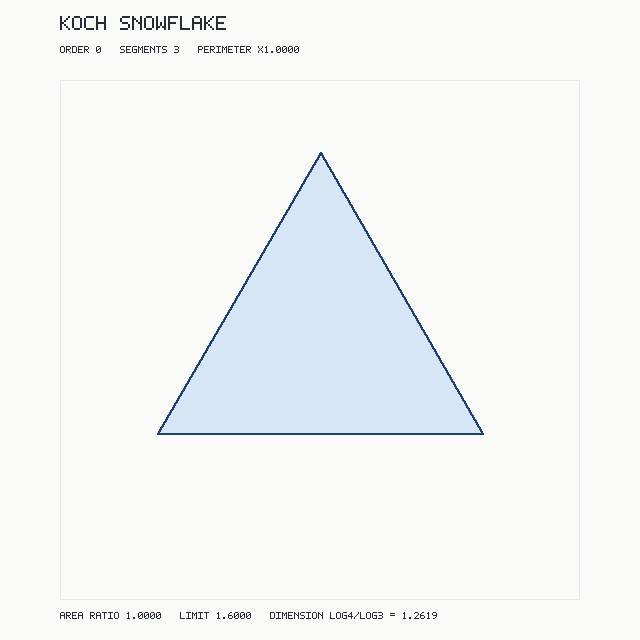
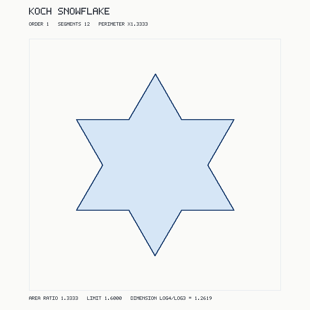
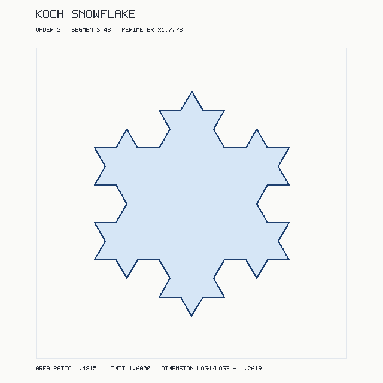
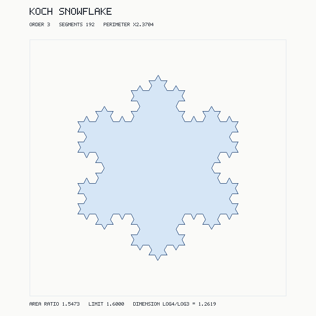
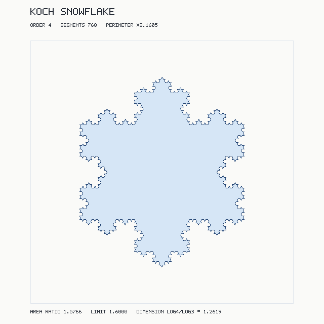

# 科赫雪花：按阶数生成（0~4 阶）

> Python 作业 · 零第三方依赖（只用标准库）· Python 3.8+ · 结果完全确定、可复现

**成果速览**（下面 5 张图均由本作业代码生成，点开可看大图）：

| 0 阶 | 1 阶 | 2 阶 | 3 阶 | 4 阶 |
| --- | --- | --- | --- | --- |
|  |  |  |  |  |

## 一、题目与运行

题目要求（PPT「homework to blog」第 2 条）：**绘制科赫雪花，根据阶数生成（0~4 阶）**。

```bash
python draw_all.py                 # 生成 0~4 阶共 5 张 PNG + 图片画廊，打印统计表
python draw_all.py 3               # 只生成 3 阶这一张（阶数可任意组合：0 2 4）
python draw_all.py --show          # 生成后自动用浏览器打开画廊看图
python selftest.py                 # 自检：递归几何、面积公式、PNG 结构、画廊
```

不需要 `pip install` 任何东西。

> **该运行哪个？** 只有 `draw_all.py`（出图 + 统计表）和 `selftest.py`（自检）能直接运行。
> `koch_snowflake.py` 是**被导入的工具模块**，里面只有函数和类的定义；单独运行会打印一句说明和一个最小演示，不会生成图片。详见第七节。

### 图在哪里看？

控制台只打印统计表和 `wrote output/...` 这样的文字——**控制台是纯文本终端，不会把图片画在窗口里，这是正常的**。图片是 `output/` 目录下的真实文件：

| 看法 | 操作 |
| --- | --- |
| 在 PyCharm 里 | 左侧项目树展开 `koch-snowflake/output/`，双击任一 `.png` 即可预览；看不到新文件就右键 → **Reload from Disk** |
| 一次看齐 5 阶 | 双击 `output/index.html`，浏览器显示图片画廊（图片已内嵌，单文件也能发给别人） |
| 最省事 | 运行 `python draw_all.py --show`，或右上角选 `04 koch-snowflake \| 生成 0~4 阶并看图` |
| 在 GitHub 上 | 本文件开头「成果速览」已直接嵌入 5 张图，网页上就能看到 |

### 教材标准写法（turtle 版）

教材（嵩天《Python语言程序设计基础》实例「科赫雪花小包裹」）用 `turtle` 递归，转角依次是 `[0, 60, -120, 60]`，三条边各右转 120°：

```python
import turtle

def koch(size, n):
    if n == 0:
        turtle.fd(size)
    else:
        for angle in [0, 60, -120, 60]:
            turtle.left(angle)
            koch(size / 3, n - 1)

def main():
    turtle.setup(600, 600)
    turtle.speed(0)
    turtle.penup()
    turtle.goto(-200, 100)
    turtle.pendown()
    turtle.pensize(2)
    level = 3                      # 阶数：改成 0~4
    for _ in range(3):
        koch(400, level)
        turtle.right(120)
    turtle.hideturtle()
    turtle.done()

main()
```

`turtle` 也是标准库，但它只能弹一个图形窗口：关掉就没了、交作业只能截图、无桌面的环境跑不了、也没法一次输出 5 个阶数做对比。所以本作业沿用这个合集「手搓图形」的思路，把结果**写成真正的 PNG 文件**：图片能保存、能复现、能随仓库提交、能在 GitHub 页面上直接显示。递归思想和教材完全一致，只是把「 turtle 转角」换成了「向量旋转」，见下一节。

## 二、递归原理

科赫曲线的构造只有一句话：**把线段三等分，中间那一段换成一个向外鼓出的等边三角形的两条边**。于是 1 段变 4 段、每段长度变成原来的 1/3。

教材的四个转角 `[0, 60, -120, 60]` 表示四段相对于原方向的偏角依次是 `0° → +60° → -60° → 0°`。本作业直接用几何算峰点，不模拟海龟：

```
p ── a        b ── q          设 v = (q - p) / 3
      \      /                a = p + v,  b = p + 2v
       apex                  apex = a + rotate_ccw60(v)
```

`rotate_ccw60` 是向量逆时针旋转 60°（对应 `turtle.left(60)`）：

```
x' = x·cos60° - y·sin60°
y' = x·sin60° + y·cos60°
```

然后递归地对 `p→a`、`a→apex`、`apex→b`、`b→q` 这 4 段做同样的事，直到 `order == 0` 时直接返回一条直线。

**雪花 = 三条边的科赫曲线首尾相接**。初始等边三角形按**顺时针**排列（顶点角度 210° → 90° → 330°），这样每条边的「左转 60°」都指向图形外侧；若按逆时针排，尖峰会朝内，画出来就不是雪花了。`selftest.py` 里会检查一阶曲线的峰点确实是 `(1.5, √3/2)`。

## 三、数学性质：有限面积、无限周长

| 阶数 n | 线段数 `3·4ⁿ` | 周长比 `(4/3)ⁿ` | 面积比 `1 + 3/5(1-(4/9)ⁿ)` |
| --- | --- | --- | --- |
| 0 | 3 | 1.0000 | 1.0000 |
| 1 | 12 | 1.3333 | 1.3333 |
| 2 | 48 | 1.7778 | 1.4815 |
| 3 | 192 | 2.3704 | 1.5473 |
| 4 | 768 | 3.1605 | 1.5766 |

- **周长发散**：每阶乘以 `4/3`，`n → ∞` 时周长趋于无穷；
- **面积收敛**：第 n 阶新增 `3·4ⁿ⁻¹` 个小三角形，每个面积是初始三角形的 `1/9ⁿ`，求和得面积比 `1 + 3/5(1-(4/9)ⁿ)`，极限 `8/5 = 1.6`；
- **分形维数**：`D = log4 / log3 ≈ 1.2619`，介于 1 维曲线和 2 维平面之间。

`selftest.py` 用**鞋带公式**直接算多边形面积，与上面的理论面积比逐阶对照（误差 < 1e-9），这比目测图形更能证明递归实现是对的。

## 四、图片是怎么「手搓」出来的

`koch_snowflake.py` 里没有任何图像库，只用了 `struct`、`zlib`、`math`：

1. 用 `bytearray` 存 RGB 像素；`line()` 是 Bresenham 直线，把递归得到的点列连起来；
2. `fill_polygon()` 用扫描线奇偶规则给雪花内部填淡蓝——边界是简单闭合曲线，所以逐行求交、两两配对即可；
3. `text()` 用自带的 5×7 点阵字模把标题、阶数、线段数「点」在图上，不依赖系统字体；
4. `save()` 自己拼 PNG 数据块：`IHDR` + `IDAT`（每行扫描线前加 1 字节 filter type 0，再 `zlib.compress`）+ `IEND`，每块都是「长度 + 类型 + 数据 + CRC32(类型+数据)」；
5. `draw_all.py` 用 `base64` 把 5 张图内嵌进 `output/index.html`，双击一个文件就能看齐全部结果。

阶数越高线段越密，所以 0~2 阶用 2px 线、3~4 阶用 1px 线，避免糊成一片。

## 五、实测结果

`python draw_all.py` 的输出（初始边长 2.0，等边三角形）：

| 阶数 | 线段数 | 顶点数 | 周长比 | 面积比 | 文件 |
| --- | --- | --- | --- | --- | --- |
| 0 | 3 | 4 | 1.0000 | 1.0000 | `output/koch_0.png` |
| 1 | 12 | 13 | 1.3333 | 1.3333 | `output/koch_1.png` |
| 2 | 48 | 49 | 1.7778 | 1.4815 | `output/koch_2.png` |
| 3 | 192 | 193 | 2.3704 | 1.5473 | `output/koch_3.png` |
| 4 | 768 | 769 | 3.1605 | 1.5766 | `output/koch_4.png` |

5 张图均为 640×640 的合法 PNG。`python selftest.py` 全部通过：点数与闭合性、线段等长且等于 `2/3ⁿ`、鞋带面积与理论公式一致、非法阶数报错、5 张 PNG 结构、画廊内嵌 5 张图。

## 六、容易踩的坑

- **三角形方向**：顶点必须顺时针，否则峰朝内，得到的是「反雪花」。
- **闭合点列**：三条边拼接时每段丢掉末点，最后补回起点，否则填充和面积计算都不闭合。
- **阶数上限**：题目是 0~4 阶；`check_order()` 会拒绝负数、>4、小数和字符串。5 阶以上有 3072 条线段，在 640px 画布上会糊掉。
- **坐标方向**：数学 y 轴向上、屏幕 y 轴向下，`Viewport.to_px()` 里必须翻转；绘图区取正方形才不会把雪花拉伸。
- **填充前提**：扫描线奇偶填充只适用于不自交的简单闭合多边形；科赫雪花满足这一点。
- **PNG 细节**：每行扫描线前那 1 字节 filter type 不能漏；CRC32 算的是「类型 + 数据」，不含长度。

## 七、文件说明

| 文件 | 作用 | 能直接运行？ |
| --- | --- | --- |
| `README.md` | 作业说明（本文件） | — |
| `draw_all.py` | **主程序**：按阶数出图、打印统计表、生成图片画廊 | 是，运行这个 |
| `selftest.py` | 自检：递归几何 + 面积公式 + PNG 结构 + 画廊 | 是，运行这个 |
| `koch_snowflake.py` | 被导入的工具模块：递归算法、点阵画布、5×7 字体、手写 PNG 编码器 | 否，被导入用 |
| `output/koch_*.png` | 生成的 5 张图（0~4 阶），已随仓库提交 | — |
| `output/index.html` | 图片画廊：5 张图内嵌在一个 HTML 里，双击即可看图 | — |
| `.gitignore` | Git 忽略清单（排除 `__pycache__` 等缓存） | — |

调用关系：

```
draw_all.py          ← 运行它（入口）
   └── koch_snowflake.py   只提供算法与画布，不自己生成文件
selftest.py          ← 运行它（检查上面两层 + 5 张图）
```

`koch_snowflake.py` 里全是函数和类的**定义**，靠 `import` 被主程序调用；直接运行时 Python 只是把定义加载一遍，控制台原本会是空的——现在它加了 `if __name__ == "__main__":` 提示块，误点会打印说明和一句演示。这正是本合集第 1 份作业讲的保护块用法。

## 八、结论

科赫雪花是「用一条递归规则反复替换自己」的分形：阶数每加 1，线段数乘 4、周长乘 4/3，但面积始终被 `8/5` 倍初始三角形包住——**有限面积里藏着无限长的边界**。本作业把教材的 turtle 画法改写成纯标准库的几何递归 + 手写 PNG 编码，一次生成 0~4 阶全部结果，可直接运行、复现、查看和交作业。
