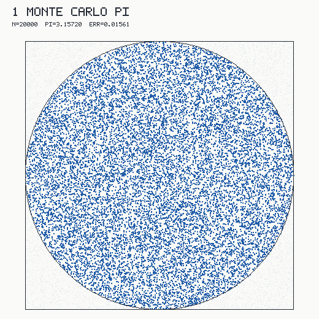
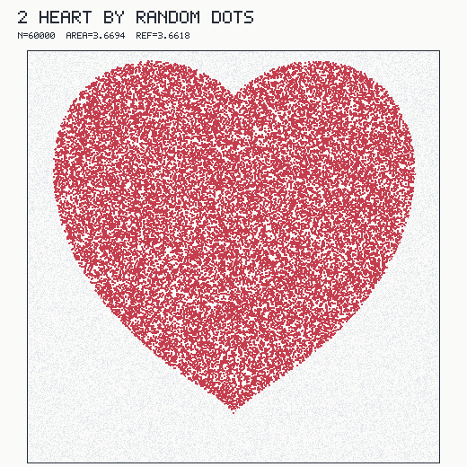
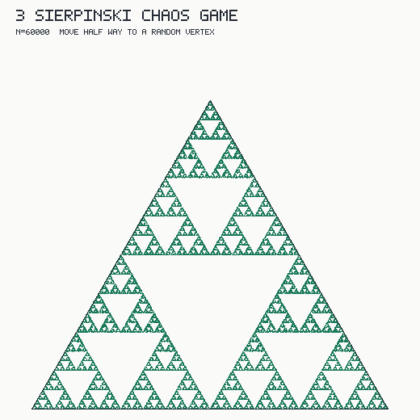
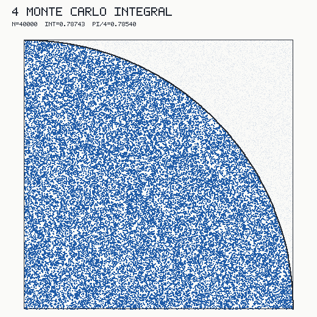
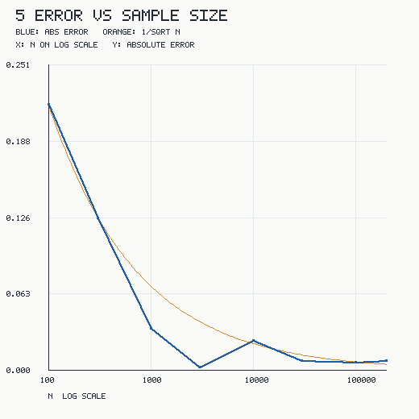
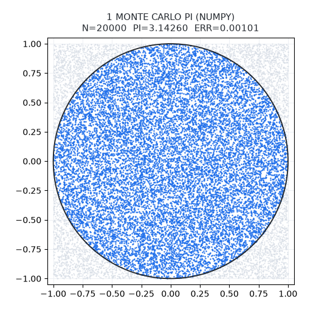
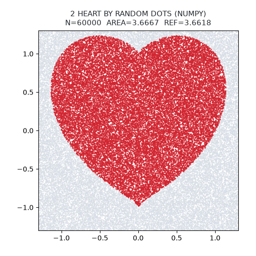
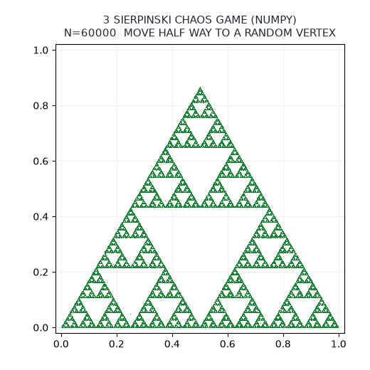
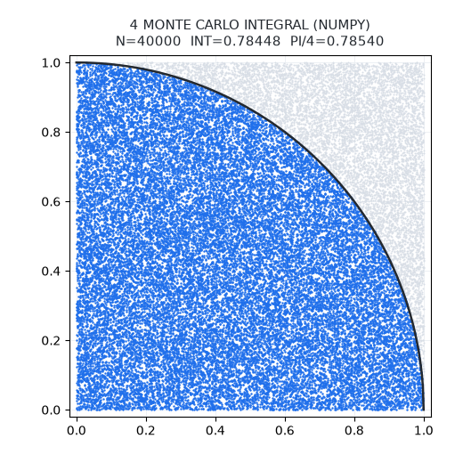
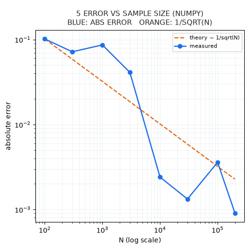

# 蒙特卡罗方法手搓图形

> Python 作业 · 主实现零第三方依赖（只用标准库）· Python 3.9+ · 固定随机种子，结果可复现
>
> 另附一个**可选的 numpy + matplotlib 对照版**，见第九节；只有它需要 `pip install -r requirements.txt`。

**成果速览**（下面 5 张图均由本作业代码生成，点开可看大图）：

| 投点估 π | 随机点心形 | Sierpinski | 蒙特卡罗积分 | 误差收敛 |
| --- | --- | --- | --- | --- |
|  |  |  |  |  |

## 一、这个作业在做什么

不用 `numpy`、`matplotlib`、`Pillow`，也不调用任何现成绘图函数：往一个区域里**扔大量随机点**，按「点是否落在目标图形内」给对应像素上色，图形就自己被「点」出来了；同时用命中率反过来估算面积、定积分和 π。

连输出的 PNG 图片都是按 PNG 规范一个字节一个字节写出来的，所以叫「手搓」。

```bash
python draw_all.py             # 运行 → 自动弹出浏览器，直接显示 5 张图案
python draw_all.py --no-show    # 只生成文件、不自动显示（无图形界面时用）
python montecarlo_numpy.py     # 运行 → 弹出图形窗口显示 5 张图案（需先装依赖）
python selftest.py             # 自检：估算精度 + PNG 结构 + 画廊
```

**运行即显示**：两个入口默认都会把图案显示在屏幕上，不需要手动去 `output/` 里点图片文件；图片文件只是顺带保存、用来交作业和贴在 README 里的副产品。

**主实现不需要 `pip install` 任何东西**；只有第九节那个可选的 numpy 对照版需要安装依赖。

> **该运行哪个？** 能直接运行的是 `draw_all.py`（主实现，运行即显示）、`montecarlo_numpy.py`（可选对照版，运行即弹窗）和 `selftest.py`（自检）。
> `mc_canvas.py`、`montecarlo.py` 是**被导入的工具模块**，里面只有 `def` / `class` 定义，没有主程序；单独点运行不会生成任何图片、控制台也不会有结果（现在会打印一句说明告诉你该运行哪个）。详见第七节。

### 运行后图案怎么显示

**运行完程序，图案会自己显示出来**，不用去点任何图片文件：

| 入口 | 运行后看到什么 |
| --- | --- |
| `draw_all.py`（零依赖主实现） | 自动用默认浏览器打开 `output/index.html`，一页显示 5 张图 |
| `montecarlo_numpy.py`（numpy 版） | 弹出一个 matplotlib 图形窗口，2×3 排布直接显示 5 张图案和统计摘要；关掉窗口程序结束 |
| 无图形界面 / 只要文件 | 两个入口都加 `--no-show`，只生成文件不弹出 |

PyCharm 里最省事的是右上角选 **`02 montecarlo | 运行即显示图案（numpy）`** 点 ▶；控制台是纯文本终端，只打印统计表，图案在自动弹出的窗口/浏览器里看。若窗口没弹出，检查是不是设了 `MPLBACKEND=Agg` 或用了 `--no-show`。

图片文件依然保存在 `output/`（`output/numpy/` 是 numpy 版），用于交作业和 GitHub 展示；`output/index.html` 里的图片是内嵌的，单独发给别人也能看。

## 二、原理

蒙特卡罗方法的核心是把要求的量写成**某个事件的概率**，再用频率近似概率（大数定律）：

```
命中率  p = M / N   ≈   P(随机点落在区域 A 内)  =  S(A) / S(采样框)
```

所以：

| 要求的东西 | 公式 |
| --- | --- |
| 区域面积 | `S(A) ≈ 采样框面积 × M / N` |
| 圆面积 / π | 在 `[-1,1]²` 里投点，`π ≈ 4 × M / N` |
| 定积分 | `∫[a,b] f(x)dx ≈ (b-a) × ymax × M / N` |

误差来自伯努利抽样，命中率的标准误是 `√(p(1-p)/N)`，所以**误差按 `1/√N` 下降**：想让误差减半，样本量要变成 4 倍。这是蒙特卡罗方法最主要的局限。

## 三、PNG 是怎么手写的

`mc_canvas.py` 里没有调用任何图像库，只用了 `struct`、`zlib`：

1. 用 `bytearray` 存 RGB 像素（每像素 3 字节）；`dot()` 就是往里写几个字节；
2. `line()` 是 Bresenham 直线算法，用来描圆、坐标轴、外框；
3. `text()` 用自带的 5×7 点阵字模把字母数字也「点」出来，不依赖系统字体；
4. 写文件时每行扫描线前加 1 字节 filter type `0`，用 `zlib.compress` 压缩；
5. 自己拼 PNG 数据块：`IHDR`（宽高、8bit、RGB）+ `IDAT`（压缩像素）+ `IEND`，每块都是「长度 + 类型 + 数据 + CRC32(类型+数据)」，前面再加 8 字节 PNG 签名。

`selftest.py` 会检查签名、`IHDR` 里的宽高、`IEND` 和文件大小，确认生成的确实是合法 PNG。

## 四、五个实验

### 实验 1 · 投点估算 π

在 `[-1,1]²` 投 20000 点，落在单位圆内的画蓝色，圆外画浅灰；圆轮廓用参数方程采样 720 段自己描出来。


### 实验 2 · 随机点填出心形并估算面积

心形隐函数 `(x²+y²-1)³ - x²y³ ≤ 0` 没有简单的解析面积。用 60000 个随机点判断是否在曲线内，命中的点画红色，图形就显现了；面积 = 采样框面积 × 命中率。参考值用 600×600 确定性细网格单独算出来，用来校验。


### 实验 3 · 混沌游戏画 Sierpinski 三角形

不是投点，而是随机迭代：每次随机选三角形的一个顶点，走到当前点与它连线的中点，重复 60000 次。点集几乎必然收敛到 Sierpinski 分形——说明随机方法也能「画」出确定性的结构。


### 实验 4 · 投点算定积分

在 `[0,1]×[0,1]` 投 40000 点，`y ≤ √(1-x²)` 的画蓝色。命中率就是四分之一圆的面积，也就是 `∫₀¹√(1-x²)dx = π/4`。


### 实验 5 · 误差随样本量的收敛

同一串随机点，记录 N 从 100 到 200000 时 `|π̂ - π|` 的变化（蓝线），叠加 `1/√N` 形状的理论参考线（橙线），可以直观看到收敛速度。


## 五、实测结果

`SEED = 20261116`，`python draw_all.py` 的实际输出：

| 实验 | 命中 / 总数 | 命中率 | 估计值 | 参考值 | 绝对误差 |
| --- | --- | --- | --- | --- | --- |
| π（投点） | 15786 / 20000 | 0.78930 | 3.15720 | 3.14159 | 0.01561 |
| 心形面积 | 32569 / 60000 | 0.54282 | 3.66944 | 3.66178 | 0.00766 |
| 定积分 π/4 | 31497 / 40000 | 0.78743 | 0.78743 | 0.78540 | 0.00203 |
| Sierpinski | 60000 次随机迭代 | — | — | — | — |

心形面积相对误差约 0.21%。π 那一行误差 0.0156：N=20000、p≈0.785 时理论标准误约 `4×√(p(1-p)/N) ≈ 0.0116`，实测在 1.4 倍标准误内，符合统计预期。

`python selftest.py` 全部通过：三项估算精度、收敛曲线、混沌游戏点数、5 张 PNG 的结构（520×520、合法 IHDR/IEND）。

## 六、容易踩的坑

- **采样框必须和计算用的矩形一致**：代码里特意把「显示范围」`[-1.05,1.05]` 和「采样框」`[-1,1]` 分开，否则 `4×M/N` 会带系统性偏差。
- **样本量不够时误差很大**：N=100 时 π 的误差可以到 0.2 以上；这是 `1/√N` 的必然结果，不是代码写错。
- **边界判定**：`<=` 还是 `<` 对结果的影响随 N 增大可忽略，但要保持一致。
- **伪随机与可复现**：用 `random.Random(seed)` 而不是全局 `random`，固定种子后每次运行结果完全一致。
- **图形可读性**：点太大太少看不出形状，太多会糊成一片；本项目用「命中点 2px、未命中 1px + 浅色」来兼顾。
- **PNG 细节**：每行扫描线前那 1 字节 filter type 不能漏；CRC32 算的是「类型 + 数据」，不含长度。

## 七、文件说明

| 文件 | 作用 | 能直接运行？ |
| --- | --- | --- |
| `README.md` | 作业说明（本文件） | — |
| `draw_all.py` | **主程序（运行即显示）**：跑 5 个实验、打印统计表、自动弹出浏览器显示图案 | 是，运行这个 |
| `selftest.py` | 自检脚本：数值精度 + PNG 结构校验 | 是，运行这个 |
| `montecarlo.py` | 采样与估算核心：面积、积分、π、收敛曲线、混沌游戏、网格参照 | 否，被导入用 |
| `mc_canvas.py` | 点阵画布、Bresenham 直线、5×7 点阵字体、手写 PNG 编码器 | 否，被导入用 |
| `output/*.png` | 生成的 5 张图（520×520），已随仓库提交，可直接查看 | — |
| `output/index.html` | 图片画廊：5 张图内嵌在一个 HTML 里，双击即可看图 | — |
| `montecarlo_numpy.py` | **可选对照版入口（运行即弹窗）**：numpy 向量化 + matplotlib 出图（见第九节） | 是，需先装依赖 |
| `requirements.txt` | 可选对照版的依赖清单（numpy、matplotlib） | — |
| `output/numpy/` | 对照版生成的 5 张 PNG + `index.html` 画廊，不覆盖手搓版图片 | — |
| `.gitignore` | Git 忽略清单（排除 `__pycache__` 等缓存） | — |

**为什么拆成 4 个 `.py`？** 一层只管一件事：改配色不用碰算法，改算法不用碰画图，这也是 Python 项目最常见的模块分工。调用关系如下：

```
draw_all.py        ← 运行它（入口）
   ├── montecarlo.py   只算数：投点、估算，不画图
   └── mc_canvas.py    只画图：像素、字体、PNG 编码，不算数
selftest.py        ← 运行它（检查上面两层 + 5 张图）
```

`montecarlo.py` 和 `mc_canvas.py` 里全是函数和类的**定义**，靠 `import` 被主程序调用。直接运行它们时 Python 只是把定义加载一遍就结束，所以控制台是空的——这不是报错，退出码也是 0。现在这两个文件都加了 `if __name__ == "__main__":` 提示块，误点时会打印一句说明和一个最小演示，告诉你要运行 `draw_all.py`。这正是本合集第 1 份作业讲的保护块用法。

`write_gallery()` 也在 `draw_all.py` 里：把 5 张 PNG 用标准库 `base64` 内嵌成一个 HTML 画廊，没有新增代码文件；加 `--show` 参数时用 `webbrowser` 自动打开它，同样只用标准库。

## 八、结论

蒙特卡罗方法把「求面积 / 积分 / 常数」换成「数随机点」，不需要知道图形的解析表达式，只要能判断「点在不在里面」就行——所以心形这种隐函数图形也能直接处理。代价是收敛慢（`1/√N`）。本作业全程只用标准库，从随机数、点阵光栅化到 PNG 文件编码都自己实现，可以直接运行、复现和交作业。

## 九、附：numpy + matplotlib 对照版（可选）

上面八节是**零依赖手搓版**，也就是本作业的主答案。课程里如果讲到 `numpy` 数组运算和 `matplotlib` 画图，可以用本节这一版对照：题目、五个实验、随机种子完全相同，只是把「自己写循环、自己编码 PNG」换成「数组向量化 + 绘图库」，正好能看出库替我们做了哪些事。

**这一版是可选的，不装依赖也能正常跑完主作业。** 它单独放在一个文件 `montecarlo_numpy.py` 里，不会改动 `draw_all.py` 的任何逻辑。

### 环境配置与运行

```bash
pip install -r requirements.txt        # 安装 numpy 与 matplotlib
python montecarlo_numpy.py             # 运行 → 直接弹出图形窗口显示 5 张图案
python montecarlo_numpy.py --no-show   # 只存文件、不弹窗（无图形界面时用）
python montecarlo_numpy.py --gallery   # 另外用浏览器打开 HTML 画廊
```

**这一版默认就弹窗显示图案**，和主实现一样不需要去点图片文件。

本机 PyCharm 项目已配置好：解释器 `D:\pycharm\venv\Scripts\python.exe`（Python 3.13.0）里已安装 **numpy 2.5.5 / matplotlib 3.11.2**（以及 matplotlib 的 9 个依赖包）。在 PyCharm 右上角下拉选 **`02 montecarlo | numpy + matplotlib 版`** 点 ▶ 即可，Settings → Python Interpreter 里能看到这些包。

图案在自动弹出的图形窗口里显示，关掉窗口后程序结束；图片同时保存到 `output/numpy/`，**不覆盖**手搓版的 `output/*.png`，作为可提交、可离线查看的副产品。控制台依旧只打印统计表。

| 投点估 π | 随机点心形 | Sierpinski | 蒙特卡罗积分 | 误差收敛 |
| --- | --- | --- | --- | --- |
|  |  |  |  |  |

### 两版写法对照

| 环节 | 手搓版 `draw_all.py` | 对照版 `montecarlo_numpy.py` |
| --- | --- | --- |
| 随机数 | `random.Random(seed)` + Python 循环逐个生成 | `np.random.default_rng(seed)` 一次生成整个数组 |
| 命中判定 | 逐点调用 Python 函数 | 数组运算 + 布尔掩码，无 Python 循环 |
| 画图 | 自己写像素、Bresenham 直线、5×7 点阵字体 | `ax.scatter` / `ax.loglog` / `Circle` |
| 输出图片 | 手写 PNG 编码器（`zlib` + `struct` + CRC32） | `fig.savefig()` |
| 第三方依赖 | 无 | numpy、matplotlib |
| 教学价值 | 看清底层每一步怎么实现 | 看清实际工程里怎么写得更短、更快 |

对照版默认使用 matplotlib 的**交互式后端**，`plt.show()` 才能弹出图形窗口（所以不再强制 `Agg`）；无图形界面时设环境变量 `MPLBACKEND=Agg` 或加 `--no-show` 即可跳过弹窗。窗口里的中文指定微软雅黑渲染，单张图片内部的标题仍用英文，避免跨字体缺字。它自己带断言式自检（估算误差、5 张图、画廊），运行结束会打印 `ALL CHECKS PASSED (numpy + matplotlib 版)`。

### 对照版实测结果

`SEED = 20261116`，`python montecarlo_numpy.py`（numpy 2.5.5 / matplotlib 3.11.2）：

| 实验 | 命中 / 总数 | 估计值 | 参考值 | 绝对误差 |
| --- | --- | --- | --- | --- |
| π（投点） | 15713 / 20000 | 3.14260 | 3.14159 | 0.00101 |
| 心形面积 | 32545 / 60000 | 3.66674 | 3.66178 | 0.00496 |
| 定积分 π/4 | 31379 / 40000 | 0.78448 | 0.78540 | 0.00092 |

和手搓版的数值略有不同是正常的：两版用不同的随机数生成器（`random.Random` vs `default_rng`），但采样口径、样本量、参考值完全一致，误差都在 `1/√N` 的统计预期内；心形参考面积两版都是 `3.66178`（同样取 600×600 格子中心的细网格）。
